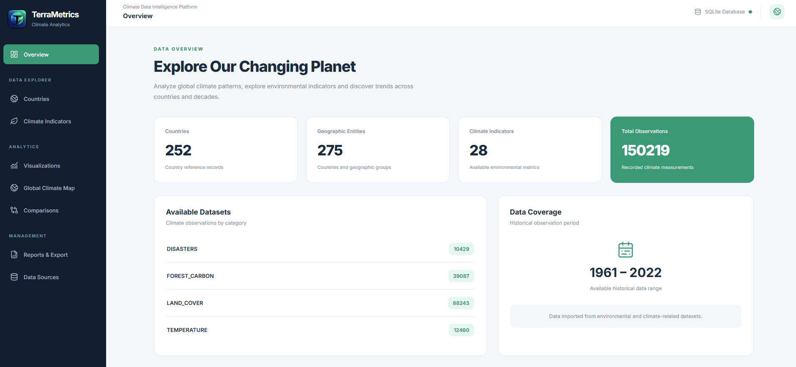
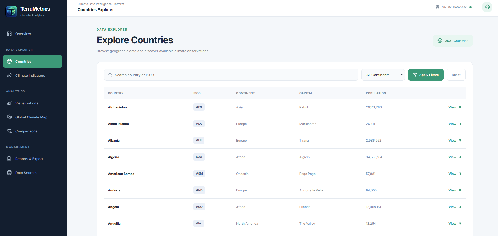
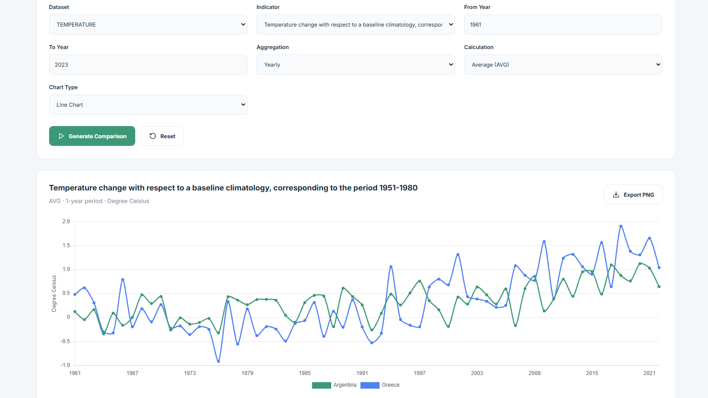
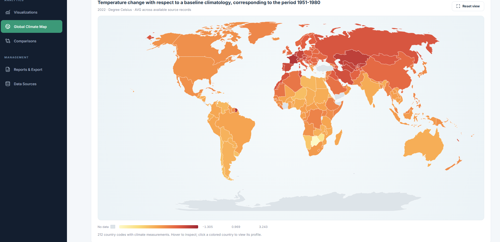
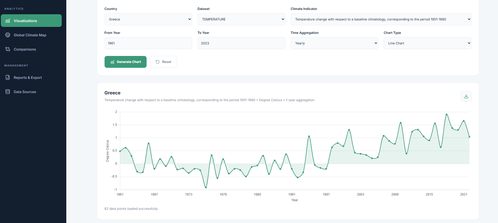

<div align="center">


# TerraMetrics

### Climate Data Analytics Platform

Explore historical climate and environmental indicators through interactive visualizations, geographical exploration, country comparisons, and exportable reports.

**Java 21** · **Spring Boot 4.1.1** · **Thymeleaf** · **SQLite** · **Spring JDBC** · **Chart.js** · **D3.js / TopoJSON**

[Overview](#project-overview) · [Features](#core-features) · [Screenshots](#application-screenshots) · [Installation](#installation--usage) · [Data](#data-sources--methodology)

</div>

---

## Project Overview

**TerraMetrics** is a full-stack, Java-based web application developed to make historical climate and environmental datasets easier to explore, compare, and understand. It combines a responsive web interface with a local SQLite database and a dedicated extract-transform-load (ETL) workflow.

Users can browse countries and climate indicators, examine trends over time, compare multiple countries, explore a global choropleth map, and generate filtered reports. The platform is designed for analytical exploration and educational use rather than real-time monitoring or official climate-risk assessment.

### Database Snapshot

| Metric | Included data |
|---|---:|
| Climate observations | **150,219** |
| Countries | **252** |
| Geographic entities, including non-country entries | **275** |
| Climate indicators | **28** |
| Source datasets | **4** |
| Overall historical coverage | **1961–2022** |

> These figures describe the included SQLite snapshot. Data availability varies by country, indicator, and year; the overall date range does not imply complete coverage for each series.

### Core Features

| Module | Capabilities |
|---|---|
| **Overview Dashboard** | Summary statistics for observations, countries, geographic entities, indicators, datasets, and historical coverage. |
| **Countries Explorer** | Search and filter countries, browse geographic information, and open country-specific views. |
| **Climate Indicators** | Explore available indicators, their source datasets, and supporting metadata. |
| **Data Visualizations** | Generate interactive time-series charts with country, indicator, year-range, and aggregation controls. |
| **Country Comparisons** | Compare climate trends across selected countries and investigate relationships between indicators. |
| **Global Climate Map** | Interactive world choropleth with indicator and year filters, contextual hover details, and clickable countries. |
| **Reports & Export** | Filter and preview analytical results, export CSV files, and open print-friendly reports for browser-based PDF saving. |
| **Data Sources** | Review dataset provenance, coverage information, and available quality checks. |
| **ETL Pipeline** | Transform source CSV files, populate normalized SQLite tables, and create a database backup. |

### Selected Capabilities

- Combined geographical, time-series, and comparative exploration of historical data.
- Responsive, server-rendered pages complemented by interactive JavaScript charts and maps.
- User-selectable time windows, grouping, and aggregation options.
- Country-level exploration from both tables and the interactive world map.
- Exportable analytical results and print-ready reporting.
- Local relational storage with a reproducible CSV-to-SQLite import workflow.

---

## Technology Stack

| Layer | Technologies |
|---|---|
| **Backend** | Java 21, Spring Boot 4.1.1, Spring Web MVC |
| **Frontend** | Thymeleaf, HTML5, CSS3, JavaScript |
| **Data Access** | Spring JDBC (`JdbcTemplate`) |
| **Database** | SQLite |
| **Data Processing** | Java ETL, OpenCSV |
| **Charts** | Chart.js |
| **Geographical Visualizations** | D3.js, TopoJSON, world-atlas data |
| **Build & Dependencies** | Maven, Maven Wrapper |

The project uses a server-rendered Spring MVC architecture. Browser-side chart and map libraries are delivered through CDNs, so **internet access is needed for these visualizations** unless those dependencies are hosted locally.

### Architecture

```text
                    Web Browser
             Thymeleaf / CSS / JS
                         |
                  Spring MVC
                    Controllers
                         |
                     Services
                         |
                JDBC Repositories
                         |
                   SQLite DB

  Source CSVs --> Java ETL --> Transformed CSVs --> SQLite DB
                                          |
                                     DB Backup
```

### Project Structure

```text
src/main/java/com/kkargas/terrametrics/
├── controller/                 # Web routes and page controllers
├── service/                    # Validation and analytical logic
├── repository/                 # SQL queries using Spring JDBC
└── etl/                        # Data transformation, loading and backup

src/main/resources/
├── templates/                  # Thymeleaf pages and fragments
├── static/
│   ├── css/                   # Application styling
│   ├── js/                    # Interactive charts, maps and reports
│   ├── images/                # Application branding and logo
│   └── screenshots/           # Application screenshots
├── data/                       # Original source CSV files
└── tf_data/                    # Transformed CSV output

data/
└── climate.db                  # Included SQLite database snapshot
```

---

## Application Screenshots

The screenshots below are stored in the repository and show the actual application interface.

### Overview Dashboard



### Countries Explorer



### Country Comparisons



### Global Climate Map



### Data Visualizations



---

## Installation & Usage

### Requirements

- **JDK 21** (or a compatible later JDK; the Maven build targets Java 21).
- Internet access to download Maven dependencies and load the chart/map CDN assets.
- Git, if cloning the repository rather than downloading its source archive.

### 1. Clone the Repository

```bash
git clone https://github.com/KonKargas/TerraMetrics.git
cd TerraMetrics
```

### 2. Run the Application

The repository includes a populated database at `data/climate.db`. **Run the application from the repository root** so that this relative path resolves correctly.

**Windows (CMD / PowerShell):**

```bat
mvnw.cmd spring-boot:run
```

**macOS / Linux:**

```bash
./mvnw spring-boot:run
```

Open **http://localhost:8080/** in your browser.

### Database Configuration

The default connection is configured as:

```properties
spring.datasource.url=jdbc:sqlite:${TERRAMETRICS_DB_PATH:data/climate.db}
```

Set the `TERRAMETRICS_DB_PATH` environment variable to use another database file. Avoid committing machine-specific absolute paths.

### Optional: Rebuild the Database

The ETL entry point is:

```text
com.kkargas.terrametrics.etl.ClimateEtlRunner
```

Run this class from your IDE with the working directory set to the repository root. It transforms the source CSV files in `src/main/resources/data/`, loads the database into `data/climate.db`, and creates a backup at `data/backups/climate-backup.db`.

> **Important:** The ETL import rebuilds or replaces the target database. Back up your existing database before running it. A running web server is not required for the ETL class.

---

## Data Sources & Methodology

The project brings together four source-data categories:

| Dataset | Number of indicators |
|---|---:|
| `TEMPERATURE` | 1 |
| `DISASTERS` | 7 |
| `FOREST_CARBON` | 6 |
| `LAND_COVER` | 14 |
| **Total** | **28** |

The database includes provenance information referring to **FAO / FAOSTAT** and **EM-DAT (CRED / UCLouvain)**. Data is historical and imported from local source files; the application does not automatically retrieve live updates.

When interpreting results:

- Missing observations must not be interpreted as zero values.
- Aggregated results reflect the observations available for the requested period; coverage may be partial.
- Choropleth color intensity expresses values for the selected indicator, not an indicator-independent measure of severity.
- Correlation does not establish causation.

**Dataset licensing:** Different providers may apply different attribution, reuse, and commercial-use conditions. The provenance records identify `CC BY-NC-SA 3.0 IGO` for certain FAO datasets. Do not assume that permission to use the application code automatically grants permission to redistribute the raw data or SQLite snapshot. Consult [DATA_SOURCES.md](DATA_SOURCES.md) and the original providers' terms before redistribution or commercial reuse.

---

## Development & Implementation

TerraMetrics was developed as a full-stack data analytics application combining backend engineering, relational data modeling, data transformation, and interactive frontend visualization. Its structure separates HTTP controllers, application services, SQL-based repositories, and dataset ingestion logic.

The project demonstrates experience with:

- Spring Boot application design and server-rendered web interfaces.
- Relational database access using Spring JDBC and SQLite.
- Processing and normalizing historical CSV datasets.
- Building interactive visualizations and geographic data views.
- Filtering, aggregation, reporting, and export workflows.

### Current Limitations

- The database represents a historical snapshot rather than a continuously updated data feed.
- Interactive chart and map assets currently depend on external CDNs.
- PDF reports are saved using the browser's **Print / Save as PDF** functionality, not a dedicated PDF backend.
- Results are intended for exploration and education, not official climate-risk assessment.

---

## Repository Scope

This public repository contains the Spring Boot source code, Maven configuration, frontend assets, ETL logic, documentation, screenshots, and an included SQLite snapshot for local use. See [DATA_SOURCES.md](DATA_SOURCES.md) for the dataset-specific attribution and reuse considerations.

**License:** No software license is declared in the repository README. Unless a license is separately added, do not assume permission to redistribute or modify the source code beyond applicable legal exceptions.

---

## Author

**Konstantinos Kargas**  
Software Developer

- Website: [kkargas.com](https://kkargas.com)
- GitHub: [KonKargas](https://github.com/KonKargas)

---

*TerraMetrics — climate data exploration, environmental insights, and interactive analytics.*
