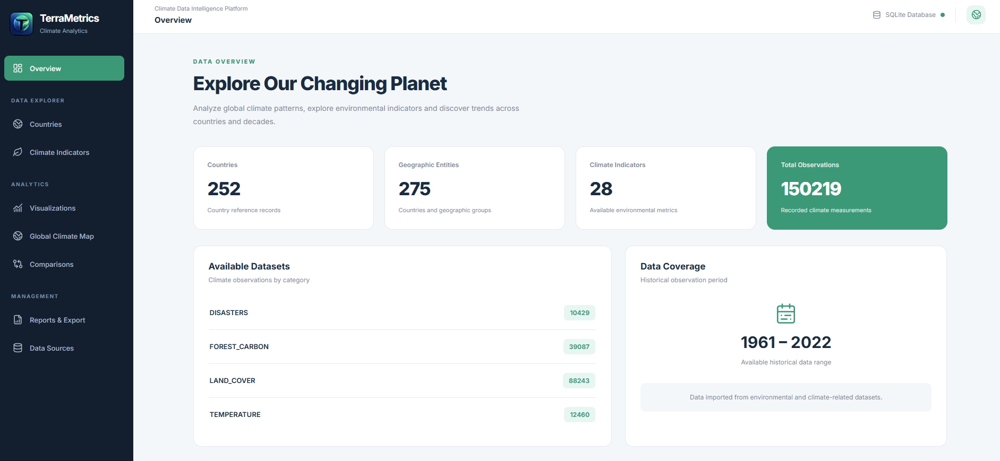
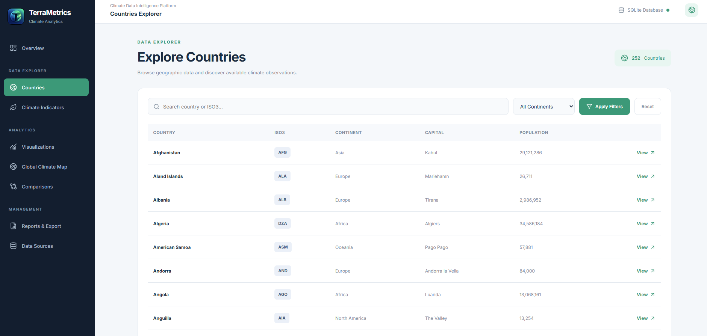
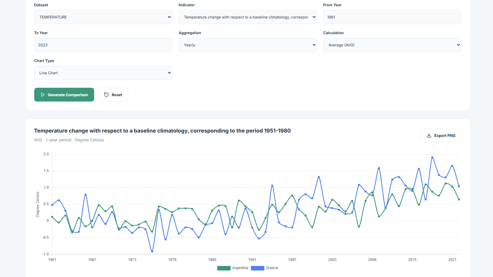
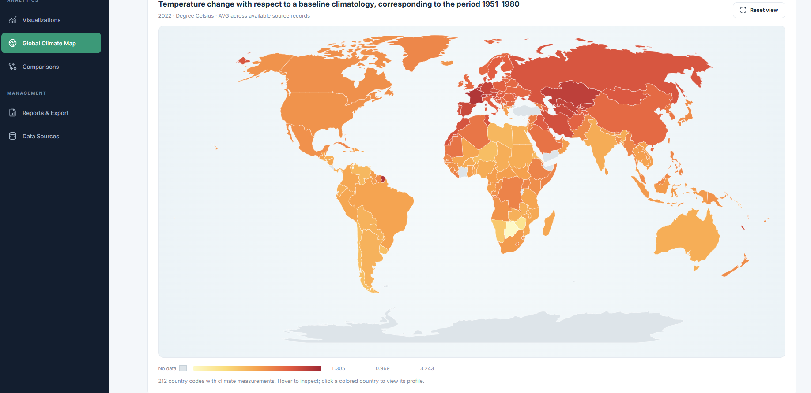
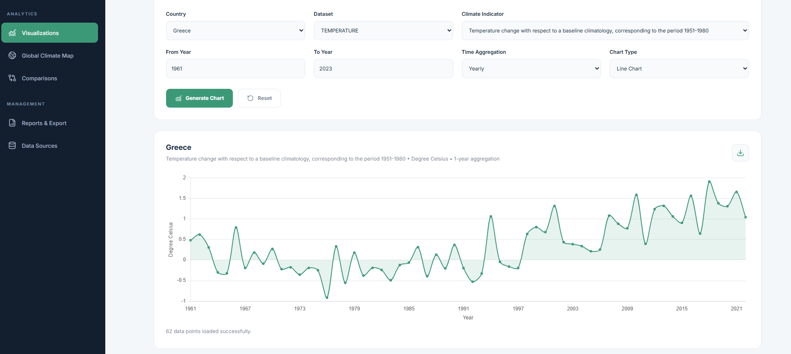

<div align="center">
  

# TerraMetrics

**Climate Data Analytics Platform**

Explore historical climate indicators with interactive charts, country comparisons, a global choropleth map, and exportable reports.

**Java 21** · **Spring Boot 4.1.1** · **Thymeleaf** · **Spring JDBC** · **SQLite** · **Chart.js** · **D3.js / TopoJSON**

[Features](#features) · [Run locally](#run-locally) · [Data and methodology](#data-and-methodology) · [Screenshots](#screenshots)
</div>

## Overview

TerraMetrics is a Java web application for exploring historical climate data from several datasets. It provides a unified SQLite-backed interface for geographic exploration, time-series analysis, multi-country comparisons, and report generation. The project also contains an ETL pipeline that transforms the source CSVs into a normalized relational database.

### Database snapshot

| Metric | Count / range |
|---|---:|
| Climate observations | **150,219** |
| Countries | **252** |
| Geographic entities (including non-country entries) | **275** |
| Climate indicators | **28** |
| Data sources | **4** |
| Observed years | **1961–2022** |

*These figures were verified against the SQLite snapshot included in this repository. Individual indicators and countries have different coverage.*

## Features

- **Overview dashboard:** dataset totals, geographic coverage, and observation range.
- **Countries Explorer:** browse/filter countries and open country details.
- **Climate Indicators:** discover indicators by dataset and inspect their metadata.
- **Visualizations:** create interactive time-series charts with year ranges and aggregation options.
- **Comparisons:** compare country trends and explore correlations between indicators.
- **Global Climate Map:** world choropleth with dataset-specific color palettes, indicator/year filters, hover information, and clickable countries.
- **Reports & Export:** filter by countries, indicator, year range, time grouping, and aggregation; preview results; export CSV or open a print-friendly report to save as PDF.
- **Data Sources:** review the imported datasets, provenance metadata, and data quality checks.
- **ETL:** transform raw CSV data into normalized tables and generate a consistent SQLite backup.

### Included datasets

| Dataset key | Indicators |
|---|---:|
| `TEMPERATURE` | 1 |
| `DISASTERS` | 7 |
| `FOREST_CARBON` | 6 |
| `LAND_COVER` | 14 |

## Tech stack

| Layer | Technology |
|---|---|
| Backend | Java 21, Spring Boot 4.1.1, Spring Web MVC |
| Views | Thymeleaf, HTML, CSS, vanilla JavaScript |
| Persistence | SQLite, Spring JDBC (`JdbcTemplate`) |
| ETL | Java, OpenCSV |
| Visualization | Chart.js, D3.js, TopoJSON, world-atlas data |
| Build | Maven, included Maven wrapper |

Frontend chart/map libraries are loaded from CDNs; **an internet connection is required** for those visualizations unless the assets are vendored locally.

## Run locally

### Requirements

- **JDK 21** or later compatible with the project (the Maven build targets Java 21).
- An internet connection for Maven dependency downloads and the visualization CDNs.
- Git (optional, for cloning).

### 1. Get the project

```bash
git clone https://github.com/KonKargas/TerraMetrics.git
cd TerraMetrics
```

> If you chose a different repository name, change the clone URL accordingly.

### 2. Start the application

The repository includes `data/climate.db`, a populated SQLite database for a first run. Start Maven **from the project root** so the relative database path resolves correctly.

**Windows (PowerShell / CMD):**

```bat
mvnw.cmd spring-boot:run
```

**macOS / Linux:**

```bash
./mvnw spring-boot:run
```

Open **http://localhost:8080/**.

If `data/climate.db` has been removed or is unavailable, regenerate it using the ETL procedure below **before** launching the web application.

### Database location

The default JDBC URL is:

```properties
spring.datasource.url=jdbc:sqlite:${TERRAMETRICS_DB_PATH:data/climate.db}
```

You can override the database path with the `TERRAMETRICS_DB_PATH` environment variable. Avoid absolute machine-specific paths in committed configuration.

### Rebuild the database from source CSVs (optional)

The source files live in `src/main/resources/data/`. The ETL entry point is:

```text
com.kkargas.terrametrics.etl.ClimateEtlRunner
```

Run this Java **main class from your IDE, with the working directory set to the repository root**. It performs:

1. Raw CSV transformation into `src/main/resources/tf_data/`.
2. Table creation and loading into `data/climate.db`.
3. A SQLite backup at `data/backups/climate-backup.db`.

**Warning:** importing rebuilds/replaces the existing `data/climate.db`; back up any changes first. The web application is not required for the ETL main class to run.

## Architecture

```text
Browser (Thymeleaf / CSS / JavaScript)
               |
     Spring MVC Controllers
               |
         Service Layer
               |
     JDBC Repository Layer
               |
        SQLite climate.db

Raw CSV -> Java ETL -> normalized CSV -> SQLite
```

Key folders:

```text
src/main/java/com/kkargas/terrametrics/
  controller/            HTTP endpoints and pages
  service/               Validation and report/chart logic
  repository/            SQL queries via Spring JDBC
  etl/                   CSV transformation, import, and backup
src/main/resources/
  templates/             Thymeleaf pages and shared fragments
  static/css/            Responsive page/component styling
  static/js/             Interactive chart/map/report scripts
  static/images/         Branding assets
  data/                  Source CSVs
  tf_data/               Transformed CSV output
 data/climate.db          Included SQLite snapshot
```

## Screenshots

### Dashboard



### Countries



### Country Comparisons



### Global Map



### Data Visualization




Suggested screenshots: dashboard, countries explorer, visualizations, comparisons, global climate map, reports, and data sources. Use real captures from your running application, not mockups.

## Data and methodology

The database's `sources` table contains provenance records referring to **FAO / FAOSTAT** datasets and **EM-DAT (CRED / UCLouvain)**. The raw source CSVs and their transformations are part of the project; they are not live data feeds. Coverage varies by country, indicator, and year.

**Important licensing note:** The embedded provenance mentions `CC BY-NC-SA 3.0 IGO` for certain FAO datasets, while other sources have separate reuse conditions. **Do not assume this project's software license also grants rights to redistribute or commercially reuse the source datasets.** Verify each provider's terms and attribution requirements before publishing or redistributing raw/transformed data or the database snapshot. See [DATA_SOURCES.md](DATA_SOURCES.md).

### Interpretation

- Missing observations are not treated as zero.
- Aggregation is based on available records; partial time-period coverage is indicated in reports.
- Color intensity in the choropleth reflects the selected indicator's numeric values; it does **not** imply universal severity or risk across all indicators.
- Correlation is descriptive, not evidence of causation.

## Roadmap / limitations

- Historical snapshot: the database is not automatically refreshed from providers.
- Chart/map CDN assets require internet access.
- PDF output uses the browser's **Print / Save as PDF** workflow; no dedicated server-side PDF generator is included.
- This is an analytical/educational project, not an official climate-risk assessment service.

## Author

**Konstantinos Kargas** — Software Developer  
[Portfolio](https://kkargas.com) · [GitHub](https://github.com/KonKargas)

## License
-
